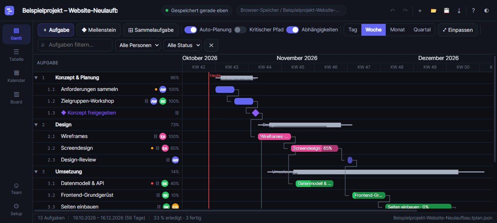
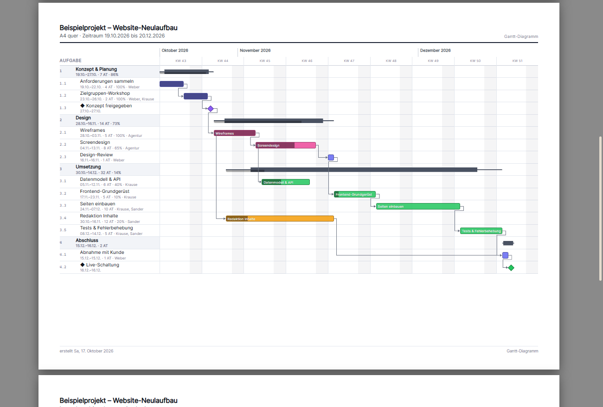
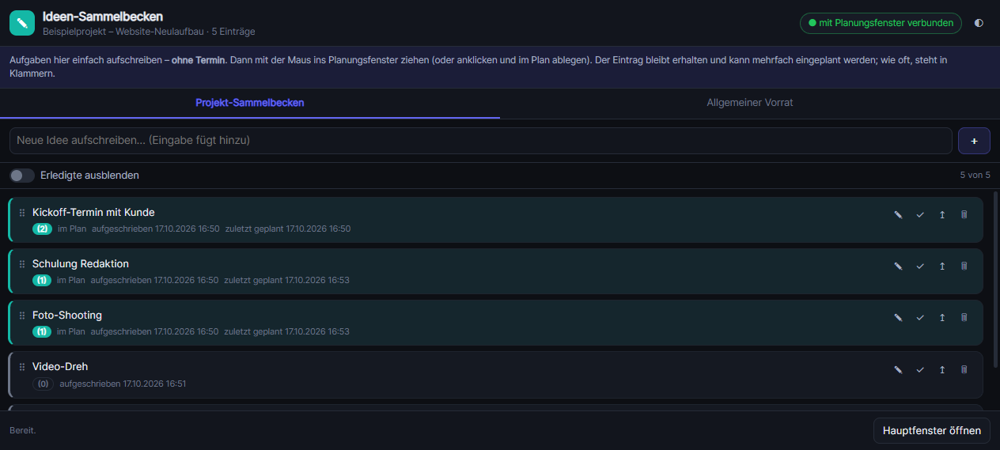

# Terminplanung

Projekt- und Terminplanung im Browser – mit **Gantt-Diagramm, Tabelle, Kalender und Board**.
Eine einzige Projektdatei, die automatisch gespeichert wird: **du musst nie auf „Speichern“ drücken**
und kannst nichts verlieren, wenn der Browser geschlossen wird.

Kein Server, kein Konto, keine Installation – reines HTML/CSS/JavaScript (ES-Module) ohne
Abhängigkeiten. Läuft als statische Seite auf **GitHub Pages** oder lokal aus einem Ordner.

**Version 02** – sie steht in der Statuszeile unten rechts, auf dem Startbildschirm, in der
Kurzanleitung und in den beiden eigenen Fenstern (Detailbereich, Ideen-Sammelbecken). Gezählt wird
in `js/version.js`; bei jedem Ausliefern wird die Zahl dort um eins erhöht.



## Was drin ist

**Vier Ansichten, ein Plan**

| Ansicht | Wofür |
|---|---|
| **Gantt** | Zeitachse mit Balken, Meilensteinen, Fortschritt und Abhängigkeitspfeilen. Balken ziehen = Termin ändern, an den Enden ziehen = Dauer ändern. |
| **Tabelle** | Alle Felder auf einen Blick, direkt bearbeitbar, gruppierbar (Status, Priorität, Person) und sortierbar. |
| **Kalender** | Monatsansicht – Aufgaben per Ziehen auf einen anderen Tag verschieben. |
| **Board** | Kanban nach Status; Karte in eine andere Spalte ziehen ändert den Status. |

**Planung wie in MS Project / GanttProject**

- Aufgaben, Sammelaufgaben (mit automatischer Zusammenfassung) und Meilensteine
- Neue Aufgaben landen auf der Ebene der markierten Zeile – auch neben einer Sammelaufgabe, nie
  ungefragt darin; eine Unteraufgabe entsteht über „Unteraufgabe hinzufügen“ oder `Alt`+`→`
- Abhängigkeiten in vier Arten: Ende→Anfang, Anfang→Anfang, Ende→Ende, Anfang→Ende – jeweils mit Puffer
- **Auto-Planung**: Verschiebt man eine Aufgabe, wandern alle Nachfolger mit
- Kritischer Pfad, Puffer pro Aufgabe, Termin-Festlegungen („muss beginnen am“, „beginnt nicht vor“ …)
- Ziel-Termine (Deadlines) mit Warnung bei Überschreitung
- Arbeitskalender: Arbeitstage und Feiertage frei einstellbar (Dauer wird in Arbeitstagen gerechnet)
- Beteiligte mit Farben, Auslastung und Zuweisung mehrerer Personen

**Neun fertige Farblayouts** (links auf **Farbe** oder oben auf **◐**)

Ein Klick genügt – die Auswahl wird gemerkt und gilt beim nächsten Start weiter:

| Dunkel | Hell |
|---|---|
| Nachtblau · Anthrazit · Tiefsee · Violettnacht · Hoher Kontrast | Tageslicht · Nordlicht · Papier · Sonnenschein |

Jedes Layout setzt Flächen, Linien, Text und Akzentfarben neu. Die Balkenfarben behalten ihre
Bedeutung (grün = erledigt, rot = blockiert …), damit Pläne vergleichbar bleiben.

**Drucken und PDF** (links auf **Drucken**, oben auf **🖨** oder `Strg`+`P`)



- Blattformat **A4 oder A3**, je hoch oder quer – oder ein **eigenes Maß**: Breite, Höhe und Rand in
  Millimetern eintippen (z. B. 400 × 300 mm), mit Bezeichnung und Knopf „hoch/quer tauschen“.
  Die Seiten werden exakt in Millimetern aufgebaut, es gibt keine halben Blätter und keine
  abgeschnittenen Zeilen.
- **Druckvorschau am Bildschirm**: „🔍 Vorschau anzeigen“ zeigt die fertigen Blätter, bevor gedruckt
  wird – mit Blattwechsel, Zoom und „Einpassen“. Gedruckt wird erst auf Klick (oder `Strg`+`P`).
- Inhalte frei zusammenklicken: **Deckblatt, Gantt-Diagramm, Tabelle, Kalender, Board, Legende**.
- Zeitraum, Zeitraster (Tage/Wochen/Monate) und Feinheit einstellbar; die Blattzahl wird laufend angezeigt.
- Reicht der Platz nicht, entstehen weitere Blätter: die Aufgabenliste wiederholt sich links,
  die Zeitachse läuft nach rechts weiter.
- Im Druckdialog **„Microsoft Print to PDF“** wählen → fertige PDF-Datei im gewählten Format.

**Aufgaben verschieben – schnell und genau**

- **Umschalt**+`←`/`→` verschiebt die ausgewählte Aufgabe um einen Arbeitstag, **Umschalt**+`Strg`+`↑`/`↓`
  um eine Woche (mit `Strg` dazu: einen Monat).
- Rechtsklick auf eine Zeile → „Termin: 1 Tag/Woche/Monat später bzw. früher“.
- Im Detailbereich rechts die Knöpfe `− 1 Monat … + 1 Monat` oder **Verschieben…** für einen
  eigenen Betrag (z. B. 3 Wochen) mit Vorschau des neuen Termins.

**Sperren (Schloss) – Termine festhalten**

- Jede Aufgabe lässt sich **sperren**: dann ändert sich daran nichts mehr (Termin, Dauer, Name,
  Fortschritt, Status, Beteiligte, Vorgänger – und löschen geht auch nicht).
- Sperren/öffnen über den Knopf **🔒 Sperren** in der Leiste, `Alt`+`L`, das Kontextmenü, den
  Detailbereich oder einen Klick auf das **🔒** neben dem Namen.
- Gesperrte Aufgaben tragen in **allen Ansichten** und im **Ausdruck/PDF** ein **🔒**.
- **Zusammenhängende Termine:** Würde ein Verschieben (bei aktiver Auto-Planung) einen gesperrten
  Nachfolger oder eine gesperrte Sammelaufgabe mitziehen, wird **gar nicht verschoben** – mit
  Hinweis, welche Aufgabe im Weg ist. Beim Rechnen bleiben gesperrte Termine immer stehen; ergäbe
  die Rechnung einen anderen Termin, wird das als Warnung gemeldet.

**Mehrere Aufgaben markieren** – wie im Explorer

| Eingabe | Wirkung |
|---|---|
| **Klick** | diese eine Aufgabe markieren (Anker) |
| **Strg** + **Klick** | einzelne Aufgabe zur Auswahl hinzufügen bzw. herausnehmen |
| **Umschalt** + **Klick** | alles **von der Anker-Aufgabe bis hierher** markieren |
| **Umschalt** + `↑`/`↓` | Auswahl zeilenweise erweitern bzw. verkleinern |
| **Strg** + `A` | alle sichtbaren Aufgaben markieren |
| `Entf` | Auswahl löschen (mit Rückfrage, `Strg`+`Z` holt sie zurück) |
| **Strg** + `C` / `V` / `D` | Auswahl kopieren / einfügen / duplizieren |
| `Esc` | Auswahl aufheben |

Sind mehrere Aufgaben markiert, zeigt der Detailbereich rechts eine **Sammelbearbeitung**: Status,
Priorität, Fortschritt, Farbe und Terminverschiebung für alle auf einmal. Markiert wird in allen vier
Ansichten; Rechtsklick auf eine markierte Aufgabe zeigt die Mehrfach-Einträge oben im Menü. „Kopieren“
legt die Auswahl zusätzlich als Text in die Windows-Zwischenablage (für Excel).

**Gantt-Bedienung mit der Maus**

| Eingabe | Wirkung |
|---|---|
| **Strg** + linke Maustaste ziehen (oder mittlere Maustaste ziehen) | Ausschnitt verschieben – wie ein Hand-Werkzeug |
| **Strg** + Mausrad | stufenlos zoomen, genau um den Mauszeiger herum |
| **Umschalt** + Mausrad | seitlich rollen |
| Mausrad | senkrecht rollen |
| **◉ Heute** oder `Leertaste` | zum heutigen Datum springen (auch wenn es außerhalb des Plans liegt) |
| **⤢ Einpassen** | ganzer Zeitraum passt in die Fensterbreite |
| Klick auf **Zoom … %** | Maßstab zurücksetzen |

**Ideen-Sammelbecken in eigenem Fenster** (links auf **Ideen**)



- Öffnet ein **eigenes Browserfenster** – ideal für den zweiten Bildschirm.
- Dort Aufgaben **ohne Termin** aufschreiben, dann mit der Maus **in den Plan ziehen** oder
  anklicken und im Plan auf die gewünschte Stelle klicken.
- Der Eintrag bleibt erhalten und lässt sich **mehrfach** einplanen; die **Zahl in Klammern**
  zeigt, wie oft er schon im Plan steht.
- Optional lässt sich je Eintrag eine **Dauer** eintragen (**Tage, Wochen oder Monate**) – freiwillig,
  darf leer bleiben. Steht sie drin, bekommt die daraus entstehende Aufgabe genau diese Länge
  (1 Woche = 5, 1 Monat = 20 Arbeitstage); ohne Angabe wird sie 1 Arbeitstag lang.
- Eingeplante Aufgaben sind **türkis** und damit sofort von den anderen zu unterscheiden.
- Die Liste wird **mit dem Projekt gespeichert**; ein **allgemeiner Vorrat** gilt für alle
  Projekte und lässt sich in neue Projekte übernehmen.

**Detailbereich in eigenem Fenster** (Standard, links auf **🗗 Detail** zum Abschalten)

- Der **Detailbereich** (alles zur markierten Aufgabe) steht in einem **eigenen Browserfenster** –
  damit hat der Plan im Hauptfenster den **ganzen Bildschirm**.
- Es geht **von selbst auf**, sobald eine Aufgabe markiert wird – auch wenn es vorher (etwa
  versehentlich) geschlossen wurde: beim nächsten Markieren ist es wieder da, an der zuletzt
  benutzten Stelle (auch auf dem **zweiten Bildschirm**).
- Es sind **dieselben Felder**, nur an anderer Stelle: Änderungen wirken sofort im Plan und
  umgekehrt. Markiert wird weiterhin im Planungsfenster.
- Beim **Beenden des Programms** wird das Fenster mit geschlossen.
- **Abschalten:** Klick auf **🗗 Detail** holt den Bereich als rechte Spalte in den Plan (Knopf
  hervorgehoben = Fensterbetrieb läuft). Die Einstellung gilt auch nach dem nächsten Start.
- Blockiert der Browser das Fenster (Popup-Blocker), bleibt der Bereich sichtbar rechts im Plan,
  mit kurzem Hinweis – es geht nichts verloren.

**Zeilenhöhe einstellbar** (Setup → „Zeilenhöhe in Listen und Gantt“)

Kompakt · normal · geräumig · sehr groß – wird sofort angewendet und im Projekt gespeichert.

**Speichern ohne Nachdenken** (siehe unten)

- Automatisches Speichern ~0,7 s nach jeder Änderung, zusätzlich alle 30 s und beim Schließen
- Sicherungskopien mit Rotation, Wiederherstellung per Klick
- Warndialog, wenn der Browser beim letzten Mal nicht mehr fertig speichern konnte

## Schnellstart

### Variante A – GitHub Pages (empfohlen, nichts installieren)

1. Repository anlegen und diese Dateien hineinlegen (Ordner `css/`, `js/`, `docs/`, `examples/` mitnehmen).
2. Im Repository: **Settings → Pages → Source: Deploy from a branch → Branch: `main` / `/ (root)`**.
3. Nach ein bis zwei Minuten ist die App unter `https://<benutzer>.github.io/<repo>/` erreichbar.

> Für das automatische Speichern in einen echten Ordner braucht es Chrome, Edge oder Opera
> (File System Access API). Firefox und Safari speichern im Browser – dort zusätzlich
> `⤓` benutzen, um die Datei zu sichern.

### Variante B – lokal starten

Doppelklick auf **`Terminstart.bat`** (Windows) bzw. `./start.sh` (Linux/macOS). Der Start
erledigt alles: freien Port suchen, kleinen Webserver starten, App im Browser öffnen. Läuft die
App schon, wird nur das Browserfenster geholt – kein zweiter Server.

Zusatzangaben sind möglich: `Terminstart.bat --port 9000` oder `Terminstart.bat --no-open`.
Das Konsolenfenster ist der Webserver und muss während der Arbeit offen bleiben (schließen beendet ihn).

> `start.bat` macht dasselbe – beide Namen funktionieren.
> Ohne Server geht es nicht, weil die App aus JavaScript-Modulen besteht (Browser-Sicherheitsregel).

### Loslegen

1. **Neues Projekt anlegen** → Namen eingeben → **Ordner wählen** (z. B. `Dokumente\Projekte`).
   Dort entsteht `mein-projekt.tplan.json`.
2. Aufgaben anlegen (`＋ Aufgabe`, `Einfg`), Termine im Gantt ziehen, Abhängigkeiten im
   Detailbereich rechts setzen.
3. Fertig – es ist bereits gespeichert. Beim nächsten Mal einfach die Seite öffnen und
   **Fortsetzen** klicken.

## Speichern im Detail

Die App kann drei Arten von Speicherorten, automatisch die beste verfügbare:

| Art | Verhalten | Voraussetzung |
|---|---|---|
| **Ordner** | Du wählst einmalig einen Ordner. Die Projektdatei liegt dort als normale Datei, jede Änderung wird sofort hineingeschrieben. Beim nächsten Start wird der Ordner wiederverwendet (Zugriff einmal bestätigen). | Chrome, Edge, Opera (https oder localhost) |
| **Browser-Speicher** | Automatisch, ohne Dialog. Die Datei liegt im geschützten Speicher des Browsers (OPFS) und überlebt Neustarts. | Chrome, Edge, Firefox, Safari |
| **Notfall** | Speichern im `localStorage`, zusätzlich `⤓` zum Herunterladen und Import per Drag & Drop. | alle Browser |

Zusätzlich:

- **Sicherungskopien**: im Unterordner `Backups` der Projektdatei, maximal 12, älteste werden
  automatisch gelöscht (oben rechts auf den Speicherort klicken → `Sicherungen ansehen`,
  Wiederherstellen mit einem Klick).
- **Absturzschutz**: Vor jedem Schreibvorgang wird eine Marke gesetzt und nach erfolgreichem
  Schreiben entfernt. Findet die App beim Start eine solche Marke, meldet sie das und bietet
  Datei bzw. Sicherungen an.
- **Schließen**: Beim Tab-Wechsel, beim Schließen und alle 30 Sekunden wird geschrieben.
  Bei einem Speicherfehler fragt der Browser vor dem Schließen nach.
- **Projekt schließen ohne die App zu schließen**: `🚪` in der Leiste oben schreibt den letzten
  Stand weg, hält das automatische Speichern an und zeigt den Startbildschirm – von dort geht es
  über **Fortsetzen**, `📂` oder `＋` weiter. Nichts geht verloren, die App bleibt offen.
- **Speicherzustand** oben in der Mitte: grün = gespeichert, gelb = wird gleich gespeichert,
  blau = speichert gerade, rot = Fehler. Der Hinweis rechts daneben nennt den Speicherort und
  öffnet beim Anklicken die Auswahl (Ordner wechseln, Browser-Speicher, nur herunterladen).

## Projektdatei

Eine Datei, lesbarer JSON-Text, Endung `.tplan.json`:

```json
{
  "format": "terminplanung",
  "version": 1,
  "meta":      { "name": "…", "created": "…", "modified": "…" },
  "settings":  { "projectStart": "2026-10-19", "calendar": { "workdays": [1,2,3,4,5], "holidays": [] } },
  "resources": [ { "id": "r…", "name": "Anna Weber", "color": "#6366f1" } ],
  "tasks":     [ { "id": "t…", "name": "…", "type": "task|milestone|summary",
                   "start": "2026-10-19", "end": "2026-10-22", "duration": 4,
                   "progress": 40, "status": "running", "priority": "high",
                   "assignees": ["r…"], "deps": [{ "id": "t…", "type": "FS", "lag": 0 }] } ]
}
```

Weitergeben = Datei kopieren. Wieder öffnen = `📂 Projekt öffnen` (oder Datei ins Fenster ziehen).
Beispiel zum Ausprobieren: [`examples/beispiel-projekt.tplan.json`](examples/beispiel-projekt.tplan.json).

## Tastenkürzel

| Taste | Wirkung |
|---|---|
| `Strg`+`Z` / `Strg`+`Y` | Rückgängig / Wiederholen |
| `Strg`+`S` | sofort speichern (sonst passiert das automatisch) |
| `Einfg` | neue Aufgabe · `Entf` löschen · `F2` umbenennen |
| `Alt`+`→` / `Alt`+`←` | einrücken / ausrücken |
| `Alt`+`↑` / `Alt`+`↓` | Zeile nach oben / unten |
| `Alt`+`L` | gesperrte Aufgabe(n) freigeben bzw. markierte sperren (Schloss) |
| **Umschalt**+`←` / `→` | Termin um einen Arbeitstag verschieben |
| **Umschalt**+`Strg`+`←` / `→` | Termin um einen Monat verschieben |
| **Umschalt**+`Strg`+`↑` / `↓` | Termin um eine Woche verschieben |
| **Umschalt**+`↑` / `↓` | Auswahl erweitern bzw. verkleinern (wie im Explorer) |
| **Strg**+`A` | alle sichtbaren Aufgaben markieren |
| **Strg**+`Klick` | einzelne Aufgabe zur Auswahl hinzufügen/entfernen |
| **Umschalt**+`Klick` | Bereich von der Anker-Aufgabe bis hierher markieren |
| **Strg**+`C` / `Strg`+`V` / **Strg**+`D` | Auswahl kopieren / einfügen / duplizieren |
| `Entf` | markierte Aufgaben löschen (mit Rückfrage) |
| `Esc` | Auswahl aufheben |
| `1` … `4` | Gantt / Tabelle / Kalender / Board |
| `Leertaste` | zu „Heute“ springen (wie der Knopf **◉ Heute**) |
| `Strg`+`P` | Druck-Einstellungen öffnen (in der Vorschau: direkt drucken) |
| `F1` | Kurzanleitung |

Die Kürzel wirken auch, wenn das Detailfenster vorn ist – nur beim Tippen in einem Feld dort nicht.

## Aufbau des Projekts

```
index.html            Oberfläche
sideboard.html        Ideen-Sammelbecken (eigenes Fenster, zweiter Bildschirm)
detail.html           Detailbereich-Aufnahme (eigenes Fenster, zweiter Bildschirm)
Terminstart.bat       Start per Doppelklick (Windows) – start.bat macht dasselbe
start.sh              Start unter Linux/macOS
css/app.css           Aussehen der Oberfläche (benutzt die Farbvariablen)
css/themes.css        die neun Farblayouts
css/print.css         Druckvorlage (A4/A3/eigenes Maß, Millimetermaße) + Druckvorschau
css/sideboard.css     Aussehen des Sammelbecken-Fensters
js/
  main.js             Start, Werkzeugleiste, Tastenkürzel, Speicherzustand
  model.js            Datenmodell, Prüfen/Reparieren von Dateien, Beispielprojekt
  scheduler.js        Terminberechnung, Abhängigkeiten, kritischer Pfad
  store.js            Zustand, Änderungen, Rückgängig/Wiederholen, Verschieben
  storage.js          Speichern (Ordner / Browser / Notfall), Autospeichern, Sicherungen
  print.js            Aufbau der Druckseiten und der Druckdialog
  themes.js           Farblayouts: Namen, Auswahl, merken
  pool.js             Ideen-Sammelbecken: Einträge, allgemeiner Vorrat
  poolhub.js          Verbindung zwischen Planungs- und Sammelbecken-Fenster
  sideboard.js        Steuerung des Sammelbecken-Fensters
  version.js          Programmversion (eine Stelle – wird an vier Orten angezeigt)
  dateutil.js         Datums- und Arbeitstagsrechnung
  ui/                 Dialoge, Detailbereich, Kontextmenü, Ablegen, kleine Helfer
                      (detailwindow.js = Detailbereich ins eigene Fenster umhängen)
  views/              gantt.js · table.js · calendar.js · board.js
docs/                 Handbuch, Testprotokoll, Screenshots
examples/             Beispielprojekt
tools/serve.py        kleiner lokaler Webserver (freier Port, kein Cache)
tools/make-example.mjs erzeugt das Beispielprojekt neu
```

Keine Abhängigkeiten, kein Build-Schritt: Datei ändern, Seite neu laden. Fertig.

## Lizenz

MIT – siehe [LICENSE](LICENSE).
